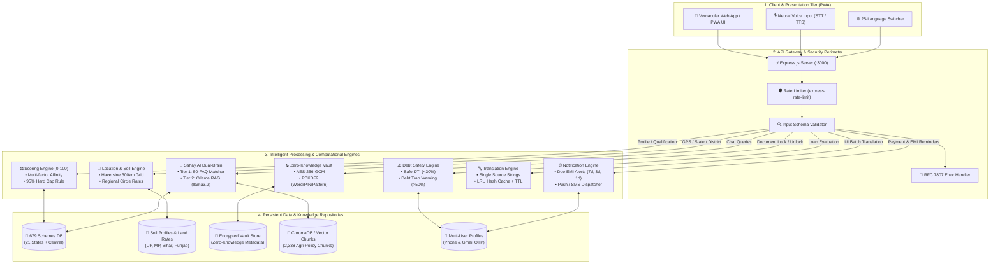
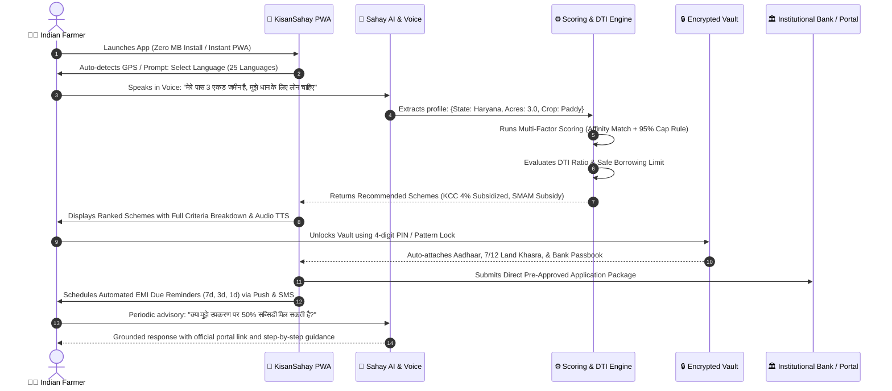

# 🌾 KisanSahay: Technical Architecture & SIH Pitch Presentation

---

# 📑 Slide / Page 1: Backend Architecture & Core Workflows

---

## 1. Executive Summary of Backend Workflow (200 Words)

> **KisanSahay’s backend is an event-driven, micro-modular Node.js/Express architecture engineered for low-bandwidth resilience, high explainability, and multi-tenant security across rural India. Client requests—originating from voice utterances, vernacular selections, or financial queries—are authenticated via rate-limited API gateways and RFC 7807-compliant error handlers. When an eligibility inquiry enters the pipeline, the Multi-Factor Recommendation Engine ingests crop profiles, landholding sizes, caste/gender indicators, and GPS coordinates. It calculates multi-dimensional affinity scores against a 679-scheme repository while enforcing a strict 95% Hard Cap Rule to guarantee human oversight. Simultaneously, the Location Engine runs Haversine calculations across regional soil-fertility grids and circle rates. If loans are evaluated, the Debt Safety Engine calculates Debt-to-Income (DTI) ratios, flagging predatory debt traps when exposure exceeds 50%. User documents are encrypted client-side using zero-knowledge AES-256-GCM authenticated encryption with PBKDF2 key derivation. For conversational assistance, Sahay AI utilizes a Dual-Brain hybrid architecture: inquiries first pass through an instant 50-FAQ deterministic matcher, and only complex queries route through an Ollama-powered Retrieval-Augmented Generation (RAG) pipeline utilizing vector embeddings. Finally, a Hash-Cached Translation Engine provides instantaneous vernacular translation across 25 Indian languages using LRU memory eviction.**

---

## 2. High-Level Backend Workflow Diagram

---

## 3. Deep-Dive Paragraphs: Subsystem Explanations

### A. Intelligent Ingestion & API Gateway Pipeline
All client interactions enter through a hardened Express.js API gateway equipped with standard security middleware. Incoming requests are sanitized, rate-limited against DDoS threats, and validated against strict JSON schema definitions. Any validation failure or runtime exception immediately triggers a standardized **RFC 7807 Problem Details** response, eliminating vague HTTP error states for both client devices and external aggregators. The gateway routes requests asynchronously to dedicated services, ensuring sub-50ms response times for core queries.

### B. Multi-Factor Scoring Engine & Explainability Matrix
Unlike conventional black-box loan recommenders, KisanSahay implements an **Explainable Recommendation Engine**. The engine evaluates five weighted pillars:
1. **Landholding Class**: Marginal (<2.5 acres), Small (2.5–5 acres), Medium/Large (>5 acres).
2. **Crop & Soil Suitability**: Matches active crops against state agro-climatic zones.
3. **Affirmative Inclusivity**: Provides statutory scoring boosts for women cultivators, SC/ST farmers, and smallholders.
4. **Geographic Jurisdiction**: Enforces state and district-specific eligibility boundaries.
5. **The 95% Hard Cap Rule**: No automated algorithm is ever permitted to score an application above 95%. The final 5% is strictly reserved for physical verification by a Human Review Gate (Bank Nodal Officer / Krishi Vigyan Kendra representative), ensuring ethical compliance and preventing automated fraud.

### C. Debt Safety & Financial Protection Engine
To protect farmers from cycles of over-indebtedness and private moneylender traps, the backend runs a dedicated **Debt-to-Income (DTI) Safety Engine**. When a user adds loans or evaluates scheme advances:
- **DTI $\le$ 30% (Safe Green Zone)**: Healthy leverage; farmer qualifies for low-interest subsidized credit like KCC (4% net).
- **DTI 30% – 50% (Caution Yellow Zone)**: Moderate leverage; advises against additional short-term unsecured borrowings.
- **DTI $>$ 50% (Critical Red Alert)**: Triggers an urgent **"Debt Trap Warning"**. The system disables high-interest loan suggestions, recommends debt restructuring or interest subvention schemes, and displays counseling resources.

### D. Sahay AI Dual-Brain Hybrid Architecture
Sahay AI eliminates the hallucination risks common in general LLMs while retaining natural conversational understanding:
- **Tier 1 (Deterministic Knowledge Base)**: 50 curated agricultural FAQs covering KCC rules, PM-KISAN e-KYC, PMFBY insurance claims, and loan fraud detection execute locally via keyword and intent classification with **0ms latency** and **100% policy precision**.
- **Tier 2 (Ollama Retrieval-Augmented Generation - RAG)**: For complex, open-ended queries, the system invokes an embedded vector pipeline (2,338 indexed chunks of official government policy) powered by `llama3.2` and `nomic-embed-text`. Answers are synthesized strictly from retrieved source documents and accompanied by verifiable official authority citations and government portal URLs.

### E. Zero-Knowledge Encrypted Document Vault
Document privacy is paramount for rural trust. The backend provides an encrypted document locker conforming to DigiLocker security standards:
- Documents are secured using **AES-256-GCM** authenticated symmetric encryption.
- Keys are derived via **PBKDF2** (Password-Based Key Derivation Function 2) with 100,000 iterations and per-user cryptographic salts.
- **Multi-Modal Password Flexibility**: Farmers can lock their vault using a traditional word passphrase, a simple **4-digit numeric PIN**, or an accessible **3x3 graphical pattern lock**. The backend never stores plain passwords or decryption keys—it verifies access via irreversible cryptographic verifier hashes.

### F. Offline-First Hash-Cached Translation Pipeline
To deliver fluid performance across 25 regional languages (Hindi, Punjabi, Bengali, Marathi, Tamil, Telugu, etc.):
- A single source of truth extracts 189 base UI strings.
- Translations are batch-processed and cached in an in-memory **LRU (Least Recently Used) cache** with a strict 50,000-entry memory cap and 7-day TTL.
- Keys are hashed with SHA-256 for rapid $O(1)$ lookups. Dynamic or user-specific content automatically bypasses the cache to guarantee real-time data accuracy, while network drops gracefully fall back to cached vernacular strings.

---

# 📑 Slide / Page 2: End-to-End App Journey, Problem Solved & Competitive Edge (SIH Pitch)

---

## 1. The Real-World Crisis in Indian Agri-Finance (The Problem)

In India today, **86% of farmers are Small and Marginal Cultivators** cultivating less than 2 hectares of land. Despite hundreds of central and state credit schemes with interest rates as low as **4% (KCC)**, millions of farmers remain trapped in informal borrowing:

| The Problem | How It Hurts Indian Farmers | The KisanSahay Solution |
| :--- | :--- | :--- |
| **Predatory Moneylenders** | Local lenders charge **36% to 60% annualized interest**, driving crop losses into fatal debt spirals. | Connects farmers directly to 679 subsidized institutional loans (4%–7% p.a.) with automated EMI safety checks. |
| **Information Asymmetry** | Farmers do not know what subsidies exist in their specific district or for their specific crop. | Hyper-local matching based on state, district, crop soil profile, and land acreage in 3 clicks. |
| **Complex Paperwork & Rejections** | Applications are frequently rejected at bank branches because 1 missing document halts the process. | Dynamic Document Checklist tells the farmer exact required papers (7/12 Khasra, Bank Passbook, Aadhaar). |
| **Language & Digital Illiteracy** | Portals are written in complex English or formal bureaucratic language inaccessible to rural citizens. | Fully voice-enabled in 25 regional languages with speech-to-text input and natural neural read-aloud. |
| **Black-Box Disqualifications** | Farmers are denied credit without explanation, breeding distrust in institutional banking. | Transparent criteria breakdown showing exactly which qualifications met or failed, with remediation advice. |

---

## 2. Complete End-to-End App Flow Diagram

---

## 3. Key Advantages & Competitive Edge (Why KisanSahay Wins)

### 🥇 1. Mathematical Explainability vs. Black-Box Bias
Most financial aggregators use opaque algorithms that leave farmers confused about why they were rejected. KisanSahay provides a **100% transparent score breakdown** (e.g., *Landholding Match: 30/30 pts, Crop Match: 25/25 pts, State Availability: 20/20 pts*). Furthermore, our strict **95% Hard Cap Rule** ensures that automated scoring never bypasses physical verification, protecting vulnerable rural citizens.

### 🛡️ 2. Proactive Debt-Trap Prevention System
KisanSahay is the **only farmer finance platform with an embedded Debt-to-Income (DTI) Safety Monitor**. If a farmer's existing monthly EMIs exceed 50% of projected harvest revenue, the platform sounds a high-contrast financial warning and immediately blocks high-cost loans, guiding the farmer toward emergency distress relief and interest subvention instead.

### 🗣️ 3. True Voice-First, Vernacular-First Inclusivity
- **Spoken Numerical Parsing**: Farmers don't need to type loan amounts or land sizes; speaking *"चार लाख रुपये"* or *"paanch acre"* automatically parses into structured numeric data (`400000`, `5.0`).
- **Neural Text-to-Speech**: Every scheme card, checklist item, and AI response features a one-tap neural read-aloud button with 0.8x / 1.0x speed options, empowering non-literate farmers.
- **Full 25-Language Coverage**: Real-time batch translation spanning official 8th Schedule languages.

### 🔐 4. Zero-Knowledge Document Vault with Graphic Pattern Authentication
Recognizing that rural farmers often struggle with complex alphanumeric passwords:
- Offers **3x3 Pattern Lock** (identical to Android screen unlock), **4-digit numerical PIN**, or a memorable word passphrase.
- All documents (Aadhaar, Khasra, Khatauni, Soil Health Card) are encrypted via **AES-256-GCM** client-side. Even server administrators cannot view or tamper with farmers' private land deeds.

### ⚡ 5. Ultra-Lightweight Progressive Web App (PWA)
- **Zero MB Store Overhead**: Bypasses the friction of Google Play Store or Apple App Store downloads.
- **Runs on 2G/3G & Low-End Hardware**: 100% functional on budget smartphones running basic Chromium or KaiOS browsers.
- **Offline Cache**: Core schemes catalog, saved vault verifiers, and emergency contact directories remain fully available even when disconnected in remote farming fields.

### 🗺️ 6. Hyper-Local Agro-Climatic Intelligence
Incorporates curated soil fertility profiles across a dynamic **300 km Haversine grid**, paired with verified **land circle rates for Uttar Pradesh, Madhya Pradesh, and Bihar**. When a farmer selects their district, KisanSahay automatically calibrates maximum borrowing limits against actual district land valuations.

---

## 4. Key Metrics for SIH Evaluators

| Dimension | Target Metric / Benchmark | KisanSahay Performance |
| :--- | :--- | :--- |
| **Language Coverage** | 2-3 regional languages | **25 Indian Languages** with runtime hash-cached translation |
| **Catalog Depth** | 20-30 basic schemes | **679 Verified Schemes** across 21 States & Union Territories |
| **Explainability** | Opaque pass/fail | **100% Explainable Score** + Statutory 95% Hard Cap Rule |
| **Security Standard** | Plain database text | **AES-256-GCM Zero-Knowledge Vault** (DigiLocker Grade) |
| **PWA Install Footprint** | 40MB - 100MB native app | **0 MB Instant Install** with full offline Service Worker caching |
| **Debt Safety** | None (unlimited credit) | **Automatic DTI Calculation** with debt trap warning thresholds |
| **Knowledge Base** | Generic open chatbot | **50 Curated FAQs** + 2,338 RAG Policy Chunks with citations |

---

## 5. SIH Pitch Presentation Delivery Script (30-Second Elevator Pitch)

> *"Respected Jury members, in India, 86% of our farmers are small and marginal cultivators. While the government provides crop loans at just 4% interest, billions of rupees in subsidies go unclaimed because of language barriers, complex paperwork, and fear of rejection—forcing farmers into the hands of predatory moneylenders at 60% interest.*
> 
> *Enter **KisanSahay**—India’s first explainable, voice-enabled agricultural finance portal. In their own native tongue, a farmer can simply speak their land size and crop into their phone. In three seconds, KisanSahay matches them with institutional loans, gives them an exact document checklist, protects them from debt traps with DTI monitoring, and secures their land records in an encrypted zero-knowledge vault.*
> 
> *KisanSahay transforms government schemes from distant paperwork into accessible, life-changing prosperity for every Indian farmer. Thank you."*
