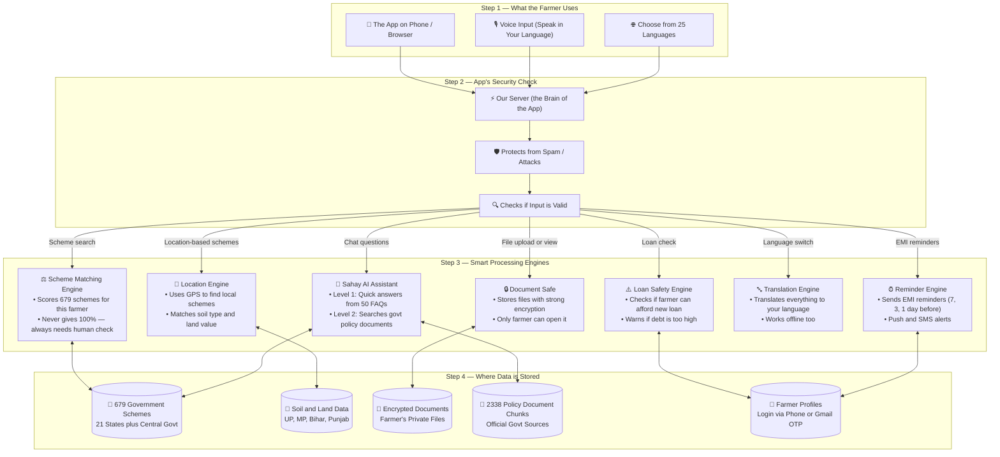
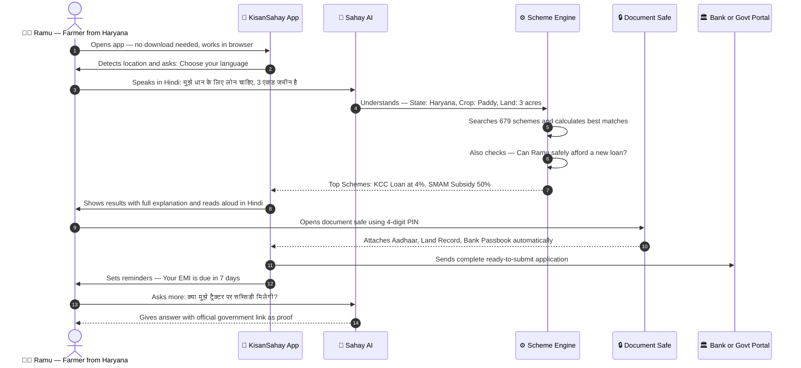

# 🌾 KisanSahay — SIH Presentation Guide

---

# 📑 Page 1: How Our App Works (Backend Explained Simply)

---

## 🔍 What Happens Behind the Scenes? (Simple Summary — ~200 Words)

> When a farmer opens KisanSahay and asks a question — whether by typing or speaking — our app quietly does a lot of smart work in the background to give the right answer.
>
> First, the app checks **who the farmer is** — their location, land size, crop, and financial situation. It then searches through a database of **679 government schemes** and finds the ones that are the best match for that farmer — like finding the right key for the right lock.
>
> If the farmer wants a loan, the app also checks whether they can safely afford it. If their current loans are already too high, it warns them before things get worse.
>
> For documents like Aadhaar or land records, the app stores them in a **locked digital safe** that only the farmer can open using a PIN, pattern, or password — even we (the developers) cannot see what is inside.
>
> For questions and help, our **Sahay AI assistant** either answers instantly from a ready-made list of common farming questions, or searches through thousands of official government policy documents to find the best answer.
>
> Everything is available in **25 Indian languages** — and works even on slow internet.

---

## 📊 App Architecture — Simple Flow Diagram

---

## 💡 Each Part Explained — In Simple Words

### A. 🚪 The Security Gate (How Requests Enter)
When a farmer types or speaks something in the app, it first goes through our **security gate**. This gate makes sure the request is clean and safe, protects the server from being overwhelmed, and checks that all required details are present before proceeding.

Think of it like a **security guard at a bank entrance** — everyone gets checked before going inside.

---

### B. ⚖️ The Scheme Matching Engine (Finding the Right Scheme)
This is the most important part. The app looks at the farmer's profile — how much land they have, what crop they are growing, where they live, and whether they belong to a priority group (women, SC/ST, etc.). Then it **scores each of the 679 government schemes** from 0 to 100 and shows the best matches on top.

> 🔑 **Important Safety Rule:** The score can never go above 95 out of 100. The last 5% must always be verified by a real person (like a bank officer). This makes sure no computer mistake causes a farmer to be wrongly approved or rejected.

---

### C. ⚠️ The Loan Safety Engine (Protecting Farmers from Debt)
Many farmers fall into debt traps — they keep borrowing until they cannot repay. Our app watches out for this:

| Situation | What the App Does |
| :--- | :--- |
| 💚 Loan payments are less than 30% of income | Safe! App shows loan options freely |
| 🟡 Loan payments are 30% to 50% of income | Caution! App advises to be careful |
| 🔴 Loan payments are more than 50% of income | Danger! App blocks high-interest loans and shows help options |

This is like a **financial doctor** who warns you before you get sick.

---

### D. 🤖 Sahay AI — Our Smart Chat Assistant
Sahay AI works in two levels, like a smart student who first checks their notebook before opening a textbook:

- **Level 1 (Quick Answers):** 50 common farming questions are already answered and ready to go. Questions like "How do I apply for KCC?" get answered **instantly with zero wait time**.
- **Level 2 (Deep Research):** If the question is something new or complex, the AI searches through **2,338 chunks of official government documents** and gives an answer with an official link as proof.

This means our AI **never guesses** — it only answers from real, verified government sources.

---

### E. 🔒 The Encrypted Document Safe (Protecting Private Files)
Farmers need to store important documents like Aadhaar, land records (Khasra), and bank passbooks. Our **digital vault** locks files using very strong encryption — the same used by banks. Farmers can unlock it using a 4-digit PIN (like an ATM), a 3x3 dot pattern (like Android phone unlock), or a secret word.

Even if someone hacks our server, they **cannot read the files** — the files are scrambled without the farmer's own key. Even we, the developers, cannot open them.

---

### F. 🌐 The Translation Engine (25 Languages, Fast)
All 189 app text items are pre-translated and stored in a smart memory cache — like keeping frequently used books on your desk instead of the library. It works offline when internet is slow or not available, and supports Hindi, Punjabi, Bengali, Marathi, Tamil, Telugu, Gujarati, Odia, and 17 more languages.

---
---

# 📑 Page 2: Why KisanSahay? — The Full Story for SIH Judges

---

## 😔 The Real Problem Indian Farmers Face Today

Imagine you are a farmer in rural Bihar. You have 3 acres of land and want to grow rice. The government offers loans at just **4% interest** — but you do not know about them. Your local bank manager speaks only formal Hindi. The forms are in English. Nobody tells you what documents to bring.

So you borrow from a **local moneylender at 36% to 60% interest**. By harvest time, your entire crop profit goes to paying interest. This is how millions of Indian farmers fall into debt traps year after year.

> **86% of Indian farmers are small and marginal farmers.** They cultivate less than 2 hectares. Despite this, billions of rupees in government subsidies go unclaimed every year — simply because farmers do not know about them or cannot access them.

---

## 🛠️ What KisanSahay Does — Step by Step (Farmer's Journey)

**In just a few minutes, Ramu went from not knowing any scheme to having a loan application ready to submit.** That is the power of KisanSahay.

---

## 🏆 Why Our App is Better — Simple Comparison

| Problem in India Today | What Other Apps Do | What KisanSahay Does |
| :--- | :--- | :--- |
| Farmers do not know which schemes they qualify for | Show a general list | Match exactly to the farmer's land, crop, and location |
| Loan forms are confusing | Give a PDF link | Auto-fill with vault documents in one tap |
| Language barrier | Only Hindi or English | 25 Indian languages with voice support |
| Farmers borrow too much | No warning | Automatically warns when debt is unsafe |
| Documents are unsafe | Stored as plain photos | Locked in encrypted safe — only farmer can open |
| AI gives wrong answers | Generic chatbot guesses | Answers only from official government sources |
| App requires phone storage | 40 to 100 MB to download | Zero MB — works directly in browser |

---

## 💪 Our 6 Biggest Strengths

### 1. 🔢 We Show Our Work (Transparent Scoring)
When a scheme is recommended, we show the farmer exactly why it matched them. No confusion, no black boxes. The farmer understands and trusts the result — which builds confidence in government schemes.

---

### 2. 🚨 We Protect Farmers from Debt Traps
We are the **only farming app in India** that automatically checks if a new loan is safe for the farmer before suggesting it. If their debt is already too high, we stop and help them find a way out — not a way deeper in.

---

### 3. 🗣️ True Voice-First Experience
- Farmer can speak their land size in their own language and the app understands it automatically
- Every result can be **read aloud** by the app in the farmer's own language
- Works for farmers who cannot read or type at all

---

### 4. 🔐 Military-Grade Document Security
We use the same type of encryption used by banks and the government. Files are scrambled and the unlock key comes only from the farmer — we never store it. Farmers choose what is easiest: pattern, PIN, or passphrase.

---

### 5. ⚡ Works on Old Phones and Slow Internet
- No app store required — just open a browser link
- Works on 2G and 3G connections
- Core features work even **offline**
- Compatible with low-cost Android phones

---

### 6. 🗺️ Knows Your Local Land and Soil
The app knows soil types, crop suitability, and land prices district-by-district. When a farmer enters their district, we use that to calculate exactly how much loan they can realistically get based on their local land value.

---

## 📈 Key Numbers — What We Have Built

| Feature | What We Achieved |
| :--- | :--- |
| Government Schemes in Database | **679 Schemes** (21 States plus Central Govt) |
| Languages Supported | **25 Indian Languages** |
| AI Knowledge Base | **2,338 Official Policy Document Chunks** |
| Common FAQ Answers | **50 Instant Answers** (zero second response) |
| Security Standard | **AES-256 Encryption** (same as DigiLocker) |
| App Install Size | **0 MB** — No download needed |
| Debt Safety Feature | **Automatic Warning System** |

---

## 🎤 Our 30-Second Pitch (For SIH Judges)

> *"Respected jury members — 86% of India's farmers are small and marginal. The government offers crop loans at just 4% interest, yet billions of rupees go unclaimed every year because of language barriers, confusing forms, and fear of rejection. Farmers end up borrowing from moneylenders at 60% interest — and slowly lose everything.*
>
> *KisanSahay changes this. A farmer simply speaks their land size and crop into their phone — in their own language. In seconds, our app finds the best government schemes for them, checks if they can safely afford a loan, auto-fills their documents from a secure vault, and submits the application.*
>
> *We do not just show information — we protect farmers from debt, speak their language, and guide them from confusion to confidence.*
>
> *That is KisanSahay — Empowering every Indian farmer, one scheme at a time. Thank you."*
